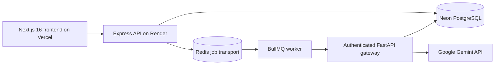
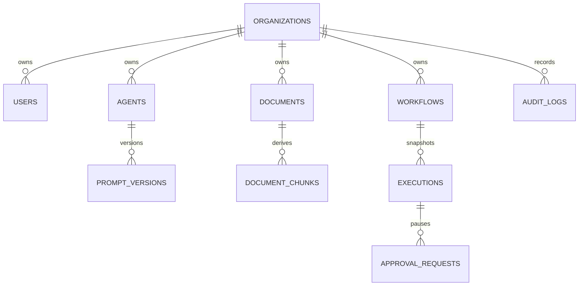

# AgentSphere

A multi-tenant agent, knowledge retrieval, and approval-workflow platform. Existing Obsidian Violet styling, orbital animation, and workflow canvas are retained.

- GitHub: https://github.com/nitinsharma2005900-ai/AgentSphere
- Live frontend: https://agentsphere-zeta.vercel.app
- API: https://agentsphere-api-nitinsharma.onrender.com/api/v1
- Health/readiness: backend host /health and /ready
- Evidence: docs/results; API specifications: docs/specs
- Updated documentation: AgentSphere_Project_Documentation.pdf

## Verified results

30 backend tests and 21 Python tests pass. The deployed API journey passes 13/13 checks, including document ingestion, actual source retrieval, tenant isolation, re-indexing, real Gemini RAG, queued approval continuation, and authenticated CSV download. A Playwright browser journey passes login, main navigation, agent dialogs, tool testing, export and mobile navigation. Both production dependency audits report zero vulnerabilities. PostgreSQL backup/restore was verified for all 15 application tables in an isolated schema, then rolled back.

Gemini 3.1 Flash Lite was verified with real API usage. The retired original model returned 404. A separate live model-selected calculator call returned 323, but its follow-up inference timed out; that execution correctly reports failure. This limitation is retained in the evidence.

All 15 mandatory assessments have been reviewed. The detailed status matrix is docs/results/assessment-status.json. Full completion is not claimed: private-repository branch protection requires GitHub Pro or public visibility, and some operational/evaluation coverage remains limited.

## Demo accounts

Synthetic demonstration password: Password123!

| Role | Email |
| --- | --- |
| Owner | owner@agentsphere.ai |
| Builder | builder@agentsphere.ai |
| Operator | operator@agentsphere.ai |
| Auditor | auditor@agentsphere.ai |
| Platform administrator | admin@agentsphere.ai |
| Separate tenant owner | competitor@external.io |

Demo seeding is explicit in hosted configuration. Disable SEED_DEMO for a private deployment and create your own accounts. Billing is a simulation; no financial charges are processed by plan changes.

## Setup and commands

Use Node 22 and Python 3.13 (the deployed container uses Python 3.11). Install backend and frontend dependencies with npm ci in each directory. Install Python dependencies with python -m pip install -r ai_service/requirements.txt.

Copy .env.example to .env. Configure unique JWT_SECRET, JWT_REFRESH_SECRET, ENCRYPTION_KEY and SERVICE_SECRET, plus GEMINI_API_KEY and DATABASE_URL. Keep .env and frontend/.env.local ignored. Secrets are never NEXT_PUBLIC variables. Choose GEMINI_MODEL=gemini-3.1-flash-lite. ALLOW_MOCK_PROVIDER=false is the hosted default. EMBEDDING_PROVIDER=local uses deterministic lexical feature vectors; choose gemini only after configuring and re-indexing the full corpus with the same embedding model.

Start the Python gateway with python -m uvicorn ai_service.main:app --port 8000. Start the API with npm --prefix backend run dev and frontend with npm --prefix frontend run dev in separate terminals. A matching SERVICE_SECRET protects internal gateway calls. Tenant identity comes from the authenticated API session, not an upload or search request field.

Build with npm run build. Apply migrations with npm --prefix backend run migrate after compiling. Migrations also run at API startup under a PostgreSQL advisory lock. Set REDIS_URL to enable BullMQ, and RUN_WORKER=true for the embedded worker; alternatively run npm --prefix backend run worker. Without Redis, development executes inline and reports that mode clearly.

Run npm test, python -m pytest ai_service/tests, npm run lint, npm run typecheck, and npm run test:e2e. The deployed API verification script exercises synthetic records and cleans up its agent, workflow, and document. Run python scripts/verify_backup_restore.py to create an encrypted backup under ignored data/backups and verify restoration in a temporary PostgreSQL schema.

## Architecture and ownership

Express owns organizations, users, sessions, agents, prompts, tool configuration, documents, execution checkpoints, approvals, audit records and simulated invoices. FastAPI owns derived document chunks/vectors only. Source uploads and tool credentials use authenticated encryption. API keys store hashes and explicit scopes. Access sessions expire after 15 minutes; refresh rotates and revokes the prior session. Logout and password changes revoke sessions. UI query caches clear when sessions change.

PostgreSQL uses relational identities, tenant foreign keys, uniqueness and query indexes, with JSONB for typed versioned payloads. The repository uses parameterized SQL and advisory locks for coupled quota/session/approval changes. It does not load a global mutable database snapshot. Development-only local storage is separate from PostgreSQL. Vector retrieval currently ranks persistent lexical feature vectors in the gateway; native pgvector indexing and semantic-model embeddings are not claimed as the deployed configuration.

## Reliability and security decisions

Workflow edges determine order; disconnected graphs and cycles are rejected. Checkpoints retain graph/context/cursor across approvals. Approval decisions are transactional and reject repeat decisions. Resumption creates a new queue job ID for the progressed checkpoint. Executions reserve token headroom before inference, enforce step/time/spending limits, record actual provider usage, and fail explicitly on unavailable or malformed output. Cancellation aborts local requests and preserves CANCELLED status. Interrupted work is recorded as failed with a retryable trace. Read-only tools avoid blind retries of side effects.

Tool arguments validate against registered JSON schemas. Credentials use AES-GCM, and tool/schema revisions are retained. External tools use HTTPS, a server host allowlist, DNS checks, pinned destination resolution, no redirects and bounded responses. Calculator uses an arithmetic parser. Tenant isolation is enforced in session scope, repository reads, document indexing, retrieval, and execution.

## Deployment and cost controls

The frontend is Vercel project agentsphere in Nitin's projects. The platform uses a free Render web service in Singapore. To avoid paid worker/Redis services, the API, inference gateway, worker and loopback-only Redis share one container. Neon is a dedicated free database. No existing resources from other applications were modified. Redis is ephemeral on this host; execution/checkpoint data lives in PostgreSQL and pending work is reconciled on startup. Cold starts, shared memory/CPU and free-plan quotas limit availability. This topology is suitable for demonstration rather than an always-on worker guarantee.

The Render service deploys manually after reviewed changes. GitHub Actions runs Python/backend tests, frontend lint/type/build, Compose validation and Docker image builds. Protecting the private main branch was attempted and rejected with HTTP 403 requiring Pro/public visibility. No paid plan was purchased and visibility was preserved.

## Remaining limitations

- Private branch protection and enforceable protected release approvals are blocked by the GitHub plan.
- No email provider is configured for forgotten-password delivery. The UI reports this honestly; authenticated password changes work.
- The deployed embedding mode is lexical feature hashing; semantic embeddings require explicit configuration and re-indexing.
- The gateway supports streaming and structured-output validation, but a live streamed UI/model journey is not part of the verified browser evidence.
- The public weather API succeeded locally but returned an upstream error from the hosted service; external provider availability is not guaranteed.
- Multi-step model responses can time out. A real calculator call followed by a provider timeout is recorded in live-tool-calling.json.
- Browser checks cover major journeys, not exhaustive permutations of every UI control or file format.
- Free hosting has cold starts and shared worker resources; no paid availability or monitoring service is provisioned.

See docs/specs/incident_simulation_rca.md for the observed defects and prevention evidence.
