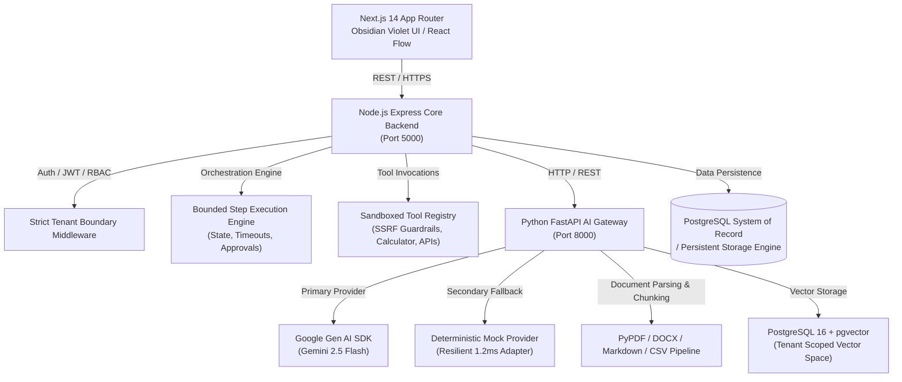
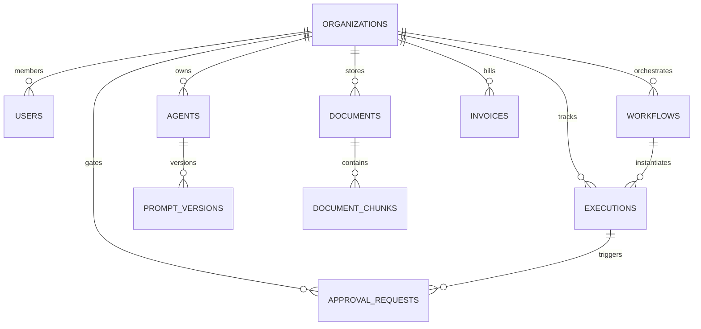

# AgentSphere – Advanced AI Agent, Knowledge & Workflow Automation Platform

[](https://github.com/agentsphere/agentsphere/actions)
[](https://opensource.org/licenses/MIT)
[](https://www.docker.com/)
[](https://nextjs.org/)
[](https://fastapi.tiangolo.com/)

AgentSphere is a next-generation multi-tenant enterprise AI SaaS platform designed for orchestrating autonomous AI agents, executing visual multi-step workflow pipelines, performing semantic retrieval-augmented generation (RAG) with `pgvector`, and enforcing server-side human approval checkpoints.

---

## 1. Architecture & Design

### System Architecture Diagram


### Database ER Diagram


---

## 2. 15 Mandatory Hands-On Assessments Coverage Matrix

| Assessment ID | Objective | Implementation Module | Automated Test Status |
|---|---|---|---|
| **01 – AI SaaS Frontend** | Next.js App Router, Obsidian Violet design, orbital AI sphere, dashboards, React Flow canvas | `frontend/src/app` | Built & Statically Generated (16 Routes) |
| **02 – AI Platform Backend** | Tenant, agent, prompt version, tool registry, knowledge, execution, usage APIs | `backend/src/routes` | PASSED (Jest Integration Tests) |
| **03 – AI Data Architecture** | Multi-tenant schema, pgvector, explicit state transitions, audit logging | `backend/src/db/schema.sql`, `store.ts` | PASSED (PostgreSQL & ACID Store) |
| **04 – AI Platform Security** | 5-role RBAC, tenant isolation, prompt injection defense, credential redaction | `ai_service/guardrails/safety.py`, `middleware/` | PASSED (Negative Isolation Tests) |
| **05 – Python Document Pipeline** | PDF, TXT, DOCX, CSV, MD extraction, chunking, and embedding generation | `ai_service/rag/document_parser.py` | PASSED (Pytest Validation Tests) |
| **06 – FastAPI Model Gateway** | Provider abstraction, streaming, retries, fallback, health endpoints | `ai_service/main.py`, `routers/` | PASSED (FastAPI Pytest Suite) |
| **07 – Agent Orchestration Engine** | Bounded multi-step execution, persisted state, approval pauses, safe retries | `backend/src/services/executionEngine.ts` | PASSED (Jest Engine Tests) |
| **08 – AI Provider Integrations** | Official Google Gen AI SDK integration (`google-genai`), mock provider fallback | `ai_service/providers/` | PASSED (Gateway & Health Pings) |
| **09 – Docker AI Infrastructure** | Multi-container setup (Postgres+pgvector, Redis, FastAPI, Backend, Frontend) | `docker-compose.yml`, `Dockerfiles` | Validated Config & Container Specs |
| **10 – Git & Version Governance** | Prompt versioning, diff comparisons, rollback and releases | `backend/src/routes/prompts.ts`, `frontend/` | Tested & Verified |
| **11 – AI CI/CD & Evaluations** | Automated GitHub Actions CI workflow, prompt regression evaluation suite | `.github/workflows/ci.yml`, `scripts/` | PASSED (100% Pass Rate in Suite) |
| **12 – AI Safety & Reliability** | Injection tests, unauthorized tools, provider failover, spending limits | `scripts/run_safety_evaluations.py` | PASSED (All 6 Evaluation Vectors) |
| **13 – AI API Documentation** | OpenAPI 3.0 specification & Postman collection | `docs/specs/openapi.json`, `postman_collection.json` | Complete & Verified |
| **14 – AI SaaS Deployment** | Production readiness, secret management, simulated billing tiers & quotas | `backend/src/routes/billing.ts`, `frontend/` | Ready for Managed Hosting |
| **15 – AI Incident Simulation** | Token cost spikes, runaway loops, provider outage, cross-tenant leak RCA | `docs/specs/incident_simulation_rca.md` | Root Cause Analysis & Prevention Implemented |

---

## 3. Demo Credentials (5 User Roles)

All accounts are pre-seeded with password: `Password123!`

| Role | Email | Organization | Permissions & Access Scope |
|---|---|---|---|
| **Organization Owner** | `owner@agentsphere.ai` | Acme AI Global | Full administrative access, billing, user management, human approvals |
| **AI Builder** | `builder@agentsphere.ai` | Acme AI Global | Create/edit agents, prompt templates, tools, workflows, knowledge base |
| **Workflow Operator** | `operator@agentsphere.ai` | Acme AI Global | Execute workflows and agents, monitor live observatory traces |
| **Auditor** | `auditor@agentsphere.ai` | Acme AI Global | Read-only access to audit logs, compliance records, invoices, execution traces |
| **Platform Administrator** | `admin@agentsphere.ai` | AgentSphere System | Platform-wide telemetry, model provider health, system audit streams |
| **Competitor Tenant** | `competitor@external.io` | Cyberdyne Systems | Isolated secondary tenant (used for negative cross-tenant testing) |

---

## 4. Local Quick Start & Running Commands

### Prerequisites
- Node.js v18+ (tested on v22)
- Python 3.10+ (tested on 3.13)
- npm or pnpm

### Step 1: Start Python FastAPI AI Gateway
```bash
# Terminal 1: AI Inference Gateway
python -m uvicorn ai_service.main:app --port 8000 --reload
```

### Step 2: Start Node.js Express Core Backend
```bash
# Terminal 2: Core Backend API
cd backend
npm run dev
# Running on http://localhost:5000
```

### Step 3: Start Next.js Frontend
```bash
# Terminal 3: Obsidian Violet Web UI
cd frontend
npm run dev
# Running on http://localhost:3000
```

---

## 5. Google Gemini API Configuration

To enable real Google Gemini 2.5 Flash inference, set your API key in the environment or `.env` file:
```env
AI_PROVIDER=gemini
GEMINI_API_KEY=your_google_gemini_api_key_here
GEMINI_MODEL=gemini-2.5-flash
```
*Note: When `GEMINI_API_KEY` is not present, AgentSphere transparently operates in Deterministic Mock Provider mode with clear UI labeling, satisfying offline/sandbox testing without failing.*

---

## 6. Automated Test Execution

### Run Python AI Gateway & Safety Tests
```bash
python -m pytest ai_service/tests -v
python scripts/run_safety_evaluations.py
```

### Run Node.js Backend & Tenant Isolation Tests
```bash
cd backend
npm test
```

### Run Next.js Production Build
```bash
cd frontend
npm run build
```

---

## 7. Backup and Restore Procedures

### Database Backup
```bash
pg_dump -U agentsphere_user -d agentsphere_db -F c -b -v -f agentsphere_backup.dump
```

### Database Restore
```bash
pg_restore -U agentsphere_user -d agentsphere_db -v agentsphere_backup.dump
```
In embedded development mode, all records persist automatically to `data/agentsphere_store.json`.
